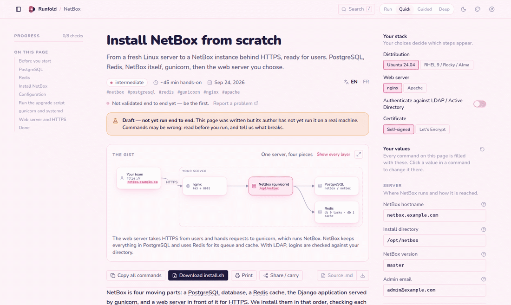
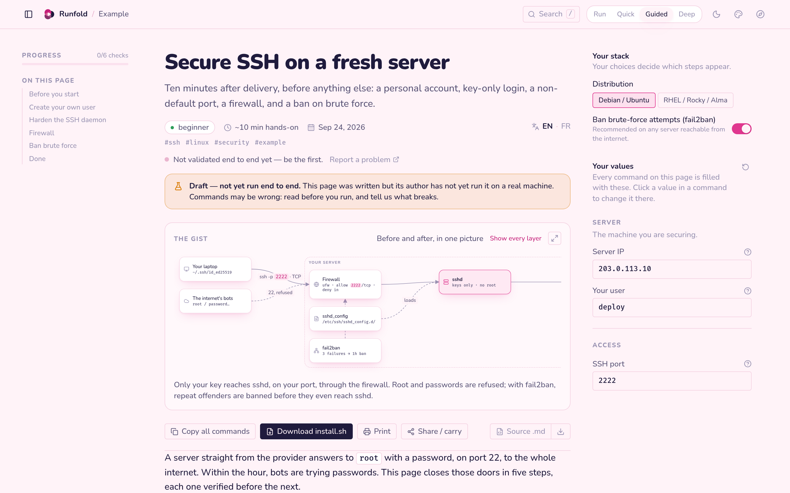
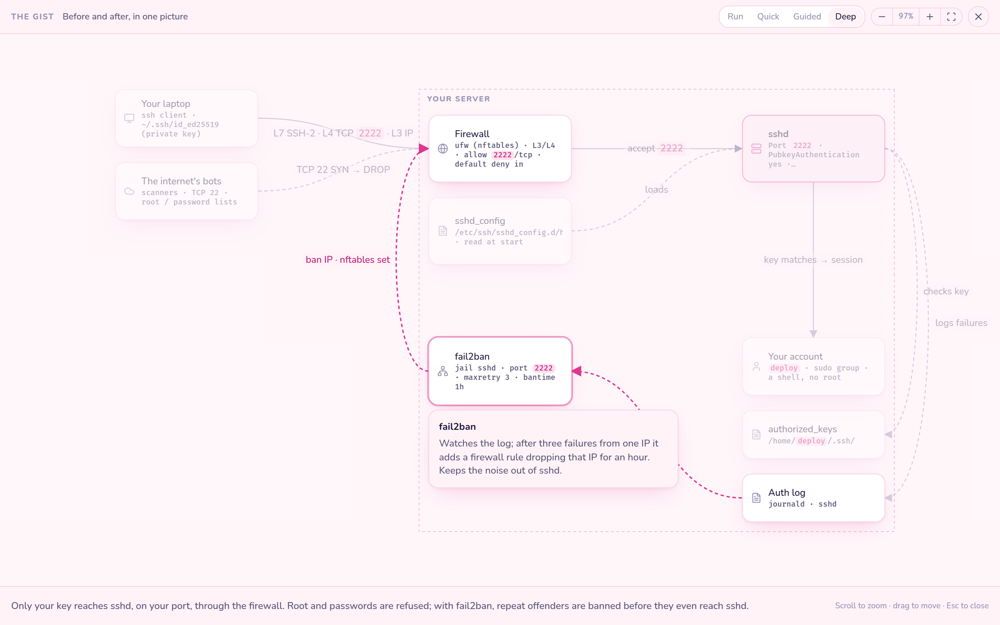
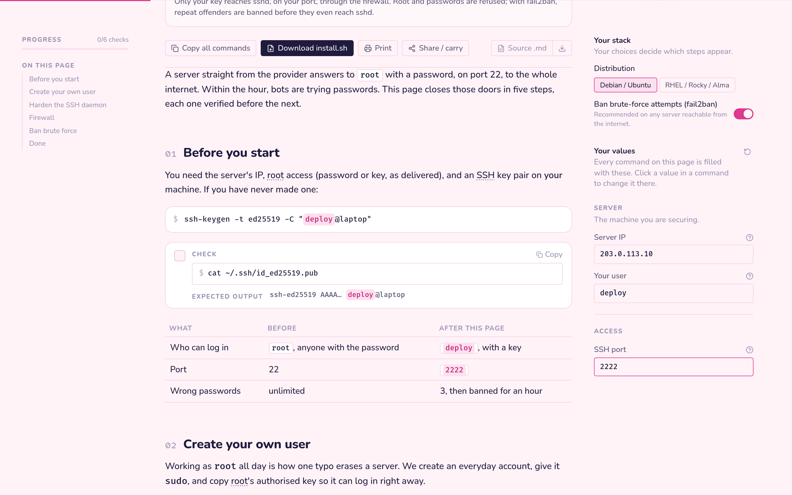
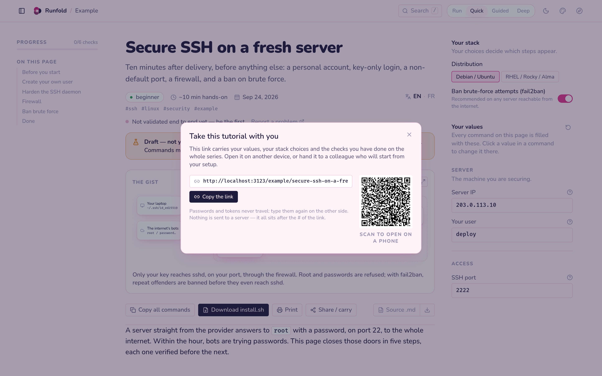
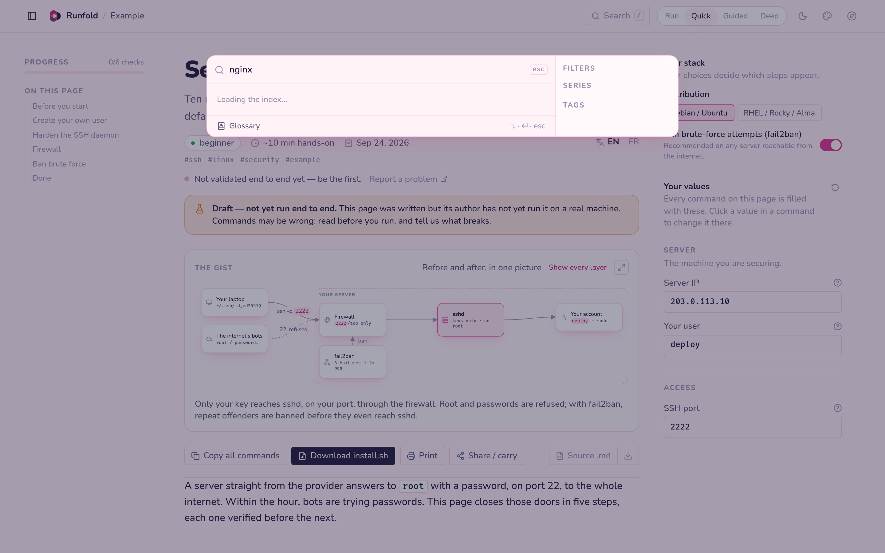
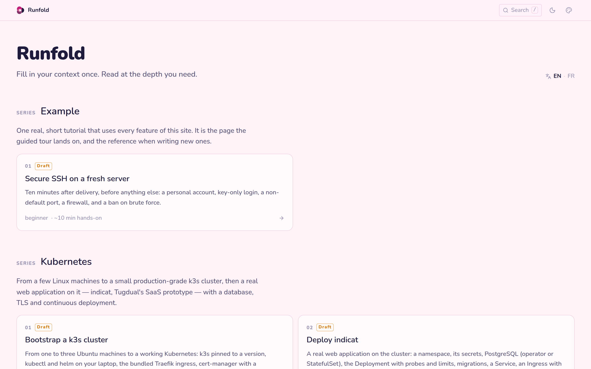
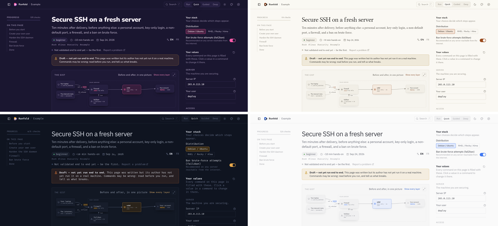

<p align="center">
  <picture>
    <source media="(prefers-color-scheme: dark)" srcset="public/brand/runfold-logo-air-dark.svg">
    
  </picture>
</p>

<h3 align="center">Run it, or unfold it.</h3>

<p align="center">
  Technical guides that adapt to the reader.<br>
  Fill in your context once, pick how deep you want to read, and every command on the page is yours.
</p>

<p align="center">
  <a href="https://demo.runfold.thudal.com"></a>
  <a href="https://github.com/7hUd41/runfold/actions/workflows/ci.yml"></a>
  <a href="LICENSE"></a>
  
  <a href="https://github.com/sponsors/7hUd41"></a>
  
</p>

<p align="center">
  
</p>

---

## The idea

> Too lazy to read? **Run** the script.
> It worked? Read **Quick** to see what it did.
> Didn't get it? Read **Guided**.
> Want to understand everything? Read **Deep**.

A Runfold page is written **once, in layers**. The reader chooses how much of it to see, and fills in **their** hostnames, ports, paths and stack (Debian or RHEL, nginx or Apache, Let's Encrypt or self-signed) in the margin. Every command is rewritten with their values; every section that does not apply to their stack disappears. What is left can be copied line by line, downloaded as one script, printed, or carried to another machine.

| Level | Shows | For |
|---|---|---|
| **Run** · *Automatique* | one script that does the whole page | you trust it, you want it done |
| **Quick** · *Express* | the commands and one line each | you have done this before |
| **Guided** · *Détaillé* | why each step, and how | first time |
| **Deep** · *Exhaustif* | the mechanism, the alternatives, the traps | you want to own it |

Runfold is also a runbook engine: a procedure with parameters, checks you can tick, and a record of who ran it on which stack.

## What you get

<table>
<tr>
<td width="50%" valign="top">

**Reading**
- Four reading levels, remembered across the site
- The gist: a live diagram at the top of every page that follows your stack and your level — simple at Quick, every layer (DNS, TLS, ports, units) at Deep. Hover a box or an arrow to read what it does; open it full screen to zoom and pan
- Outline with progress, search (`/`) across every page with series and tag filters, glossary with hover definitions
- Printing as read, eight skins with light and dark, keyboard shortcuts, a guided tour

</td>
<td width="50%" valign="top">

**Your context**
- Values and stack choices filled once per series, validated as you type (IPs, CIDRs, ports, hostnames…), each explained in full on hover
- Click any value inside a command to change it in place
- Copy all commands, or download them as an install script
- **Share / carry**: a link and a QR code that carry your values, choices and progress to another device or a colleague — in the URL fragment, never sent to a server, never your secrets

</td>
</tr>
<tr>
<td width="50%" valign="top">

**Trust**
- Checks after each step: a command, its expected output, a box to tick
- Human validation: "I tested it all, it works" records the date and the stack (never the values); every page shows how many times, how recently, and on your path
- **Stuck here?** on every step opens an issue already filled with the page, the step, your level and your stack
- Draft pages say so, loudly, until their author has run them end to end

</td>
<td width="50%" valign="top">

**Writing**
- A page is a folder: `tuto.yaml` (variables, choices), `page-en.mdx`, `page-fr.mdx`, `diagram.yaml`
- A handful of components: `<Guided>`, `<Deep>`, `<When>`, `<Run>`, `<Check>`, `<Tabs>`, `<Annotated>`…
- The test suite compiles every page in every language and refuses an undeclared variable or mismatched headings
- [AUTHORING.md](AUTHORING.md) is a self-contained brief: hand it to a person or a model with a subject, get the page back. **Source .md** on any page exports its files plus the brief

</td>
</tr>
</table>

<p align="center">
  
  
  
  
  
  
</p>

<p align="center">
  
</p>

## Get started

```bash
git clone https://github.com/7hUd41/runfold.git
cd runfold
npm install
npm run dev        # http://localhost:3000
```

```bash
npm test           # engine + every page in every language
npm run typecheck
npm run lint
npm run build      # production build; `npm start` serves it
```

Requires Node 22. Author mode (writing validations from the browser, the upcoming editor) is on in development, and off in production unless `AT_AUTHOR=1`.

## Write a page

```
content/<series>/series.yaml          what every page of the series shares
content/<series>/<page>/tuto.yaml     this page's variables, choices and metadata
content/<series>/<page>/page-en.mdx   the prose, in layers
content/<series>/<page>/page-fr.mdx   same headings, in French
content/<series>/<page>/diagram.yaml  the gist
```

````mdx
## Install nginx

```bash
sudo apt install -y nginx
sudo ufw allow ${HTTPS_PORT}/tcp
```

<Guided>nginx terminates TLS and hands requests to the app on the loopback.</Guided>

<Deep>Why not expose the app directly: …</Deep>

<Check cmd="curl -sI https://${DOMAIN}" expect="HTTP/2 200" />
````

Everything else — the contract schema, every component, the diagram language, the checklist — is in **[AUTHORING.md](AUTHORING.md)**. How the site itself works is in [docs/REFERENCE.md](docs/REFERENCE.md).

## Content in this repository

All pages are **drafts** for now: written, not yet run end to end by their author. They say so on the page.

| Series | Pages |
|---|---|
| **Example** | Secure SSH on a fresh server — uses every feature, the target of the guided tour |
| **NetBox** | Install from scratch · Configure for your team · Maintain and upgrade · Automate with the API |
| **Kubernetes** | Bootstrap a k3s cluster · Deploy a real app · Deploy on push with CI |
| **NetDevOps lab** | containerlab topology · NetBox as source of truth · Render and push configs · Validate in CI |

## Built with

Next.js 16 (App Router, statically generated pages), React 19, MDX 3, Tailwind CSS 4 (design tokens only), Zod, Vitest. Fonts are self-hosted: Libertinus, Fira Code, Nunito, IBM Plex Sans, Bricolage Grotesque. No tracking, no account, no backend needed to read.

<details>
<summary><b>Repository layout</b></summary>

```
content/            the tutorials
src/engine/         pure TypeScript: templating, conditions, validation, scripts, diagram layout, carry links — unit-tested
src/content/        loads and checks content/, compiles MDX, builds the search index — integrity-tested
src/reader/         the reading UI
src/i18n/           UI strings, English and French
src/urls.ts         every URL the site links to
src/app/            routes: /en /fr, /<series>/<page>/<lang>, …/validations, …/source.md
public/brand/       logo kit — regenerated by scripts/brand.py
docs/               reference and README media
```

</details>

## Sponsorware

Runfold is MIT-licensed and stays so. New features ship first to **Runfold Insiders**, a private edition for [sponsors](https://github.com/sponsors/7hUd41), and are released to everyone as funding goals are reached — the model [Material for MkDocs](https://squidfunk.github.io/mkdocs-material/insiders/) made work. Candidates for Insiders: company brand kit and shared defaults, polished PDF export, sync through a GitHub gist, "what changed since I last read this page", pages replayed nightly in CI.

## Roadmap

- **In-place editor** (1.0): edit a page in the browser, every save is a git commit, history in the UI
- **Living runbooks**: pages as procedures, a record of every run, links from an alert to the runbook pre-filled
- The logo animation (unfold / run), themed QR codes, the diagram as a progress map
- More series; every draft validated on real machines

## Contributing

The most useful contribution is the **Stuck here?** link on a step that did not work, or the **I tested it all** button on a page that did. Pages and code: see [CONTRIBUTING.md](CONTRIBUTING.md). Please sign off your commits (DCO).

## License

[MIT](LICENSE) © 2026 thudal ([@7hUd41](https://github.com/7hUd41)). The Runfold name and logo identify this project; please do not use them for a fork you distribute.
